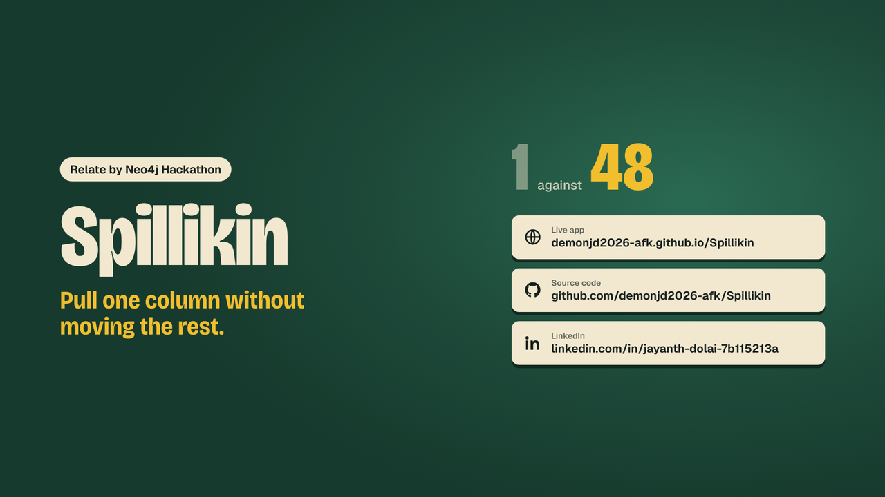
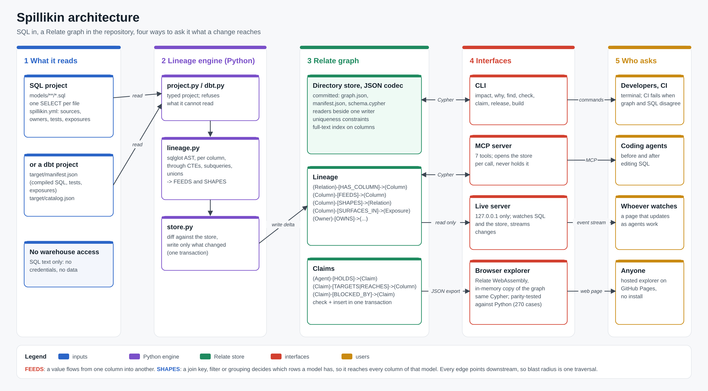

<p align="center">
  <a href="https://youtu.be/w529NDxRyRk"></a>
</p>

<h1 align="center">Spillikin</h1>

<p align="center"><strong>Pull one column without moving the rest.</strong><br>
Column lineage for coding agents: Spillikin turns a SQL project into a column-level graph stored in <a href="https://relatedb.ai">Relate</a>. Before an agent edits a model, it asks the graph what the change reaches, and whether another agent's change reaches the same place.</p>

<p align="center">
  <a href="https://youtu.be/w529NDxRyRk"><strong>Demo video</strong></a> ·
  <a href="https://demonjd2026-afk.github.io/Spillikin/"><strong>Live explorer</strong></a> ·
  <a href="#try-it"><strong>Try it</strong></a> ·
  <a href="#for-judges-where-to-look"><strong>For judges</strong></a>
</p>

<p align="center">
  <a href="https://github.com/demonjd2026-afk/Spillikin/actions/workflows/ci.yml"></a>
  <a href="https://github.com/demonjd2026-afk/Spillikin/actions/workflows/pages.yml"></a>
  
  
  <a href="LICENSE"></a>
</p>

Built by [Jayanth Dolai](https://www.linkedin.com/in/jayanth-dolai-7b115213a/) for the **[Relate by Neo4j Hackathon](https://relate.devpost.com/)**. A spillikin is a stick in the game of pick-up sticks: you win by lifting one out without disturbing the pile.

## Contents

- [The problem](#the-problem)
- [What Spillikin does](#what-spillikin-does)
- [Try it](#try-it)
- [For judges: where to look](#for-judges-where-to-look)
- [How it uses Relate](#how-it-uses-relate)
- [Setup and run](#setup-and-run)
- [Where the data lives](#where-the-data-lives)
- [Architecture](#architecture)
- [How it is verified](#how-it-is-verified)
- [Limits](#limits)
- [Third-party software and data](#third-party-software-and-data)

## The problem

A coding agent is asked to change how `raw.orders.status` is populated. It searches the repository, finds one model that selects the column, edits it, and reports success.

The column is also the filter in `int_order_totals`. Every row of every model below that filter changes, including the revenue dashboard and the month-end export, and none of those queries mention `status`.

```
$ spillikin impact raw.orders.status
logic raw.orders.status
  reaches 48 columns in 7 models and 4 exposures  (0 break outright, 1 by value, 47 by row membership, 41 with no test)
```

One column is reached by value. Forty-seven are reached because the column decides which rows exist. Text search and file-level dependency graphs see the first kind only.

## What Spillikin does

It is for teams that let agents (or people in a hurry) edit SQL models. It answers three questions, from the command line or as MCP tools:

| Question | Command | MCP tool |
|---|---|---|
| What does this change reach, and who owns it? | `spillikin impact` | `blast_radius` |
| Is someone else already changing something that meets mine downstream? | `spillikin claim` | `claim_change` |
| What did my edits actually do, compared with the last known graph? | `spillikin check` | `check_working_tree` |

`spillikin live` puts all three on one page that updates as agents edit files and open claims.

## Try it

**In the browser.** Open https://demonjd2026-afk.github.io/Spillikin/. The page loads the lineage graph into Relate's WebAssembly build and runs the same Cypher in the tab. Click a column to see what it moves, switch to **It is dropped or renamed** to see which models stop compiling, or press **Play two agents colliding** to watch one agent's claim stop another's.

**On your machine.** Python 3.10 or later, no account, API key or server:

```bash
git clone https://github.com/demonjd2026-afk/Spillikin.git && cd Spillikin
python -m venv .venv && source .venv/bin/activate
pip install -e ".[dev]"
spillikin impact raw.orders.status --project examples/meridian
```

The graph is committed with the code, so the last command answers immediately. [Setup and run](#setup-and-run) has the full walkthrough.

**From an agent.** Add the MCP server to Claude Desktop or any MCP client: see [Connect an agent](#connect-an-agent).

## For judges: where to look

| Judging criterion | Where to see it |
|---|---|
| Relate and connected context | [How it uses Relate](#how-it-uses-relate): the graph model, the traversal, and the Relate features used. The Cypher is in [`src/spillikin/analysis.py`](src/spillikin/analysis.py) and [`claims.py`](src/spillikin/claims.py). |
| Functionality and completeness | Every command in [Setup and run](#setup-and-run) works on the committed store. [How it is verified](#how-it-is-verified) lists the tests and CI checks. |
| Usefulness | [The problem](#the-problem): a change that text search reports as one model reaches 48 columns and 4 things people look at. |
| Documentation and reproducibility | [Try it](#try-it) needs four commands and no account. [Where the data lives](#where-the-data-lives) and [Limits](#limits) say what is in the repository and what is not supported. |
| Creativity | Row membership as a relationship (`SHAPES`), so a filter or join key reaches every column of the model it shapes, and claims between agents stored in the same graph as the lineage. |

## How it uses Relate

**Mode: a directory store with the JSON snapshot codec**, at `examples/meridian/store/`.

Why this mode and not a single `.rl` file or `:memory:`:

- **Readers and a writer at once.** Relate lets other processes open a directory store read-only while one process holds the writer lease. A `.rl` file cannot be opened at all while a writer holds it. Agents query constantly and write rarely (only to record a claim), so this is the mode that fits.
- **It has to outlive the process.** The graph is the baseline that `check` compares the working tree against, so it is committed to the repository.
- **Plain text on disk.** The JSON snapshot can be read without Relate, and a build that changes nothing leaves it byte-identical. CI rebuilds the graph and fails if the committed snapshot no longer matches the SQL.

**What the graph models.** Every relationship points the way data flows.

```
(:Relation {kind: source|model})-[:HAS_COLUMN]->(:Column)
(:Column)-[:FEEDS {kind: passthrough|expression|window|aggregate}]->(:Column)   value flows into
(:Column)-[:SHAPES {roles: [join|filter|group]}]->(:Relation)                  decides which rows exist
(:Relation)-[:UPSTREAM_OF]->(:Relation)
(:Column)-[:SURFACES_IN]->(:Exposure {kind: dashboard|export|ml_model|reverse_etl})
(:Owner)-[:OWNS]->(:Relation | :Exposure)
(:Agent)-[:HOLDS]->(:Claim)-[:TARGETS]->(:Column)        what an agent intends to change
                   (:Claim)-[:REACHES]->(:Column)        everything that change reaches
                   (:Claim)-[:BLOCKED_BY]->(:Claim)      a refused attempt, and whose claim stopped it
```

**Why a graph.** Because the edges point downstream, the blast radius is one traversal. `SHAPES` followed by `HAS_COLUMN` is the hop that carries a filter or join key to every column of the model it shapes:

```cypher
MATCH (seed:Column {id: 'raw.orders.status'})
MATCH p = SHORTEST 1 (seed)-[:FEEDS|SHAPES|HAS_COLUMN]->+(hit:Column)
MATCH (hit)-[:SURFACES_IN]->(e:Exposure)
RETURN e.id AS exposure, count(DISTINCT hit) AS columns_at_risk, min(length(p)) AS nearest_hops
ORDER BY exposure
```

| exposure | columns_at_risk | nearest_hops |
|---|---|---|
| churn_model | 5 | 6 |
| crm_sync | 4 | 6 |
| month_end_close | 4 | 4 |
| revenue_dashboard | 4 | 5 |

**Relate capabilities used**

- Embedded Python library (`relate-db` 1.2.0): the engine runs inside the CLI and the MCP server, with no service to start.
- Cypher 25 `SHORTEST` path selection over several relationship types, `COLLECT {}` / `COUNT {}` / `EXISTS {}` subqueries, and `CALL (x) { ... UNION ... }`.
- Uniqueness constraints on every node key.
- A full-text index queried with `SEARCH ... SCORE AS`, used to turn a phrase such as "paid revenue" into column ids.
- Transactions: a claim's collision check and its insert are one transaction under the single writer lease. Six processes racing to claim the same column get exactly one grant (see `tests/test_graph.py`).
- Read-only opens beside the writer.
- The WebAssembly build (`@relate/relate-wasm` 1.2.0) as an in-memory store in the browser explorer. It cannot open a store from disk, so the explorer loads `web/public/graph.json`, an export of the committed store that CI keeps identical to it.

## Setup and run

Requires Python 3.10 or later. No account, API key or server is needed.

```bash
git clone https://github.com/demonjd2026-afk/Spillikin.git
cd Spillikin
python -m venv .venv && source .venv/bin/activate      # Windows: .venv\Scripts\activate
pip install -e ".[dev]"
export SPILLIKIN_PROJECT=examples/meridian           # PowerShell: $env:SPILLIKIN_PROJECT = "examples/meridian"
```

The graph is already in the repository, so queries work immediately:

```bash
spillikin impact raw.orders.status                   # a filter column: 1 by value, 47 by rows
spillikin impact stg_payments.amount --change drop   # which models stop compiling, what is blocked behind them
spillikin why fct_revenue_daily.paid_revenue_usd     # back to raw sources, with each transformation
spillikin find paid revenue                          # full-text search
```

Two agents whose edits never share a file, colliding on one export:

```bash
spillikin claim raw.payments.amount --agent claude-code --change retype --intent "store payment amounts in minor units"
spillikin claim raw.fx_rates.usd_rate --agent codex --intent "switch to mid-market FX rates"
# refused: this change meets work already claimed
#   claude-code holds clm_... (store payment amounts in minor units)
#     shared columns: fct_orders.is_fully_paid, fct_orders.paid_usd, fct_revenue_daily.paid_revenue_usd, ...
#     shared exposures: month_end_close
spillikin claims
spillikin release <claim id> && spillikin claims --prune
```

Catching an edit after the fact. Delete the `amount,` line from `examples/meridian/models/staging/stg_payments.sql`, then:

```bash
spillikin check        # exits 1: int_payments_by_order no longer compiles, month_end_close is reached, no claim covers it
git checkout examples/meridian/models
```

Other commands: `spillikin build` re-syncs the graph after you change SQL, `spillikin export` writes it as JSON, and every command takes `--json`.

Run the tests with `pytest -q` (27 tests).

### Use it on a dbt project

Spillikin reads what dbt already wrote, so macros and Jinja are dbt's job:

```bash
cd your-dbt-project
dbt compile && dbt docs generate          # writes target/manifest.json and target/catalog.json
spillikin build --project .               # the store is created at ./store
spillikin impact seed.raw_orders.id --project .
```

Models, seeds, sources, column tests and exposures come from the manifest; seed and source columns come from the catalog. Tested against dbt's public [jaffle_shop](https://github.com/dbt-labs/jaffle_shop) project (dbt-core 1.12.7, dbt-duckdb 1.11.1): 8 relations, 38 columns, and `seed.raw_orders.id` reaches 17 columns, 14 of them through joins. It also reported that `customers.total_order_amount` is documented in that project but no longer output by the model.

Also run on the larger [jaffle-shop](https://github.com/dbt-labs/jaffle-shop) project, whose models use macros, `dbt_utils`, window functions and CTEs named after the models they wrap: 19 relations, 112 columns, 87 value edges, and dropping `ecom.raw_orders.id` reaches 46 columns, 10 of which stop compiling. To build it locally that project's `require-dbt-version` was relaxed to run on dbt-core 1.12 and its seeds were loaded with `--vars '{load_source_data: true}'`.

### Watch it live

```bash
cd web && npm ci && npm run build && cd ..     # once; needs Node 22 or later
spillikin live                                  # http://127.0.0.1:4321
```

Leave the page open and, in another terminal, make the claims above or edit a model. The page shows each claim, each refused attempt with the columns where the two changes meet, and every edit on disk that the graph does not know about yet, within about a second. The server binds to 127.0.0.1, answers only to that name, serves only the explorer build, and never writes.

### Connect an agent

Add this to your MCP client's configuration:

```json
{
  "mcpServers": {
    "spillikin": {
      "command": "spillikin",
      "args": ["serve"],
      "env": { "SPILLIKIN_PROJECT": "/absolute/path/to/spillikin/examples/meridian" }
    }
  }
}
```

Tools: `blast_radius`, `provenance`, `find_columns`, `claim_change`, `release_claim`, `open_claims`, `check_working_tree`. Each call opens the store for the length of that call, so every agent session can run its own copy of the server against the same store.

## Where the data lives

| Path | What it is |
|---|---|
| `examples/meridian/store/graph.json` | The Relate snapshot: 169 nodes and 338 relationships |
| `examples/meridian/store/manifest.json` | Store metadata written by Relate |
| `examples/meridian/store/.relate/schema/schema.cypher` | Constraints and the full-text index, as Cypher |
| `examples/meridian/spillikin.yml` | Sources, owners, tests and exposures |
| `examples/meridian/models/` | The 15 SQL models the graph is built from |
| `web/public/graph.json` | The same graph exported for the browser explorer |

The write-ahead log and lock files are not committed. Relate recreates them the first time the store is opened for writing, which `spillikin` does for you on a fresh clone. Claims are runtime state: they live in the same store so they can be joined to lineage, and the committed snapshot holds none. Relate rewrites the snapshot when claims are made, so git shows the store as modified while claims exist. `spillikin claims --prune` removes finished claims, and once none are left it rebuilds the store, which returns the snapshot to the committed bytes.

## Architecture



```
src/spillikin/
  project.py     manifest and model files -> typed project; resolves ref() and source(), refuses other template tags
  dbt.py         the same typed project from dbt's manifest.json and catalog.json
  lineage.py     sqlglot AST -> FEEDS and SHAPES per model, traced through CTEs, subqueries and set operations
  store.py       opening Relate, schema, and a diff-based sync so an unchanged project writes nothing
  analysis.py    blast radius, provenance, search: the Cypher lives here
  claims.py      claims and collision detection
  workflow.py    build, check and prune
  cli.py         command line
  mcp_server.py  MCP tools
  live.py        local page server: watches the SQL and the store, streams changes to the explorer
web/src/
  engine.ts      Relate WebAssembly: loads the graph, runs the Cypher, same rules as analysis.py
  Board.tsx      the lineage board: one lane per model, curved arrows measured from the rendered tiles, step-by-step playback
  App.tsx        the explorer: search, change kind, result panel, claims and live activity
  Site.tsx       the page around the explorer, with light and dark themes
  live.ts        the event stream from `spillikin live`
```

Decisions worth knowing about:

- **Structural and semantic changes are different.** Dropping or renaming a column makes every model that names it fail to compile, so all of that model's columns break, including ones the column never fed. Changing a column's type or logic compiles fine and lets values drift. `--change` selects which.
- **`check` uses the store as its baseline**, so it needs no git plumbing, and it re-extracts lineage from the working tree, so a model that no longer compiles is reported by the SQL analyser and not inferred.
- **Refusals are kept.** A refused claim is stored with a `BLOCKED_BY` relationship to the claim that stopped it, so "who was stopped, by whom, and where" is a query.
- **Nothing is guessed.** An unknown column, an undeclared source, a cycle or an unsupported template tag is an error with a location.
- **Labels and relationship types in statement text are constants.** Everything that comes from a user or a file is passed as a Cypher parameter.

## How it is verified

- **27 tests** (`pytest -q`) cover lineage extraction, the graph sync, blast radius, claims, the live server and the dbt reader. One test starts six processes that race to claim the same column and checks that exactly one is granted.
- **Continuous integration** runs on every push and fails if any of these is false:
  - the committed Relate store matches a fresh build from the SQL;
  - `web/public/graph.json` matches an export of that store;
  - the browser engine (Relate WebAssembly) and the Python engine give the same blast radius for every column, for both kinds of change: 270 comparisons over 135 columns.
- **Fresh clone** tested on Linux (Python 3.13) and macOS on Apple silicon, with relate-db 1.2.0, sqlglot 30.35 and mcp 2.3. The explorer was tested in headless Chromium with Node 22.
- **MCP** tested in Claude Desktop: `blast_radius` returned the same 48 and 59 columns as the command line, and the claim, refusal and release flow ran through the server.
- **dbt reader** run on two public dbt projects; results are under [Use it on a dbt project](#use-it-on-a-dbt-project).

## Limits

- Models must be single `SELECT` statements. In a native project only `ref()`, `source()` and `config()` template tags are understood; other Jinja is refused, not skipped. For anything more, compile with dbt and point Spillikin at the dbt project.
- The dbt reader has been run on two public projects (8 and 19 relations), both on DuckDB; other adapters' SQL dialects are parsed by sqlglot but have not been exercised here. Exposures in dbt name models, not columns, so every column of the model is treated as read.
- Column lineage through table functions and `UNNEST` is not traced.
- Sources must declare their columns in `spillikin.yml` (native) or appear in dbt's catalog.

## Third-party software and data

[Relate](https://github.com/relatedb/relate) (Apache-2.0), [sqlglot](https://github.com/tobymao/sqlglot) (MIT), [PyYAML](https://pyyaml.org) (MIT), the [MCP Python SDK](https://github.com/modelcontextprotocol/python-sdk) (MIT), pytest (MIT). The explorer uses React, Vite, Tailwind CSS, Motion and Radix UI (all MIT), a tooltip adapted from shadcn/ui (MIT) and a number ticker adapted from Magic UI (MIT), and the Bricolage Grotesque, Geist and Geist Mono typefaces (SIL Open Font License). Meridian is a fictional company; its schema and models were written for this project and contain no real data.

## License

Apache-2.0. See [LICENSE](LICENSE).
